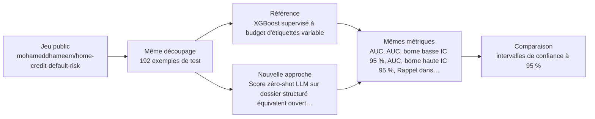
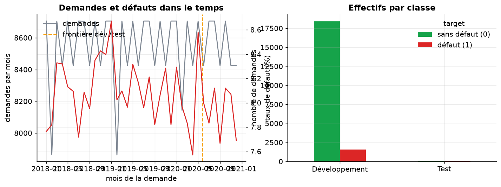
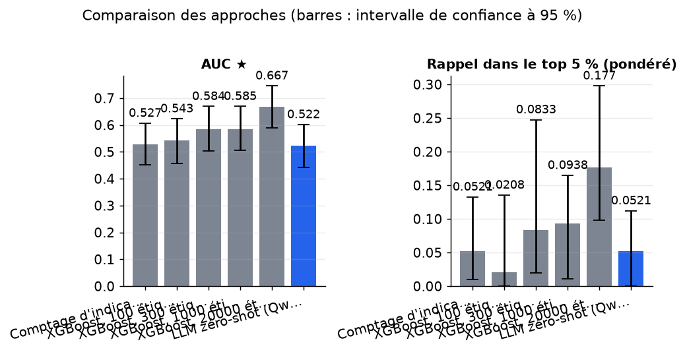
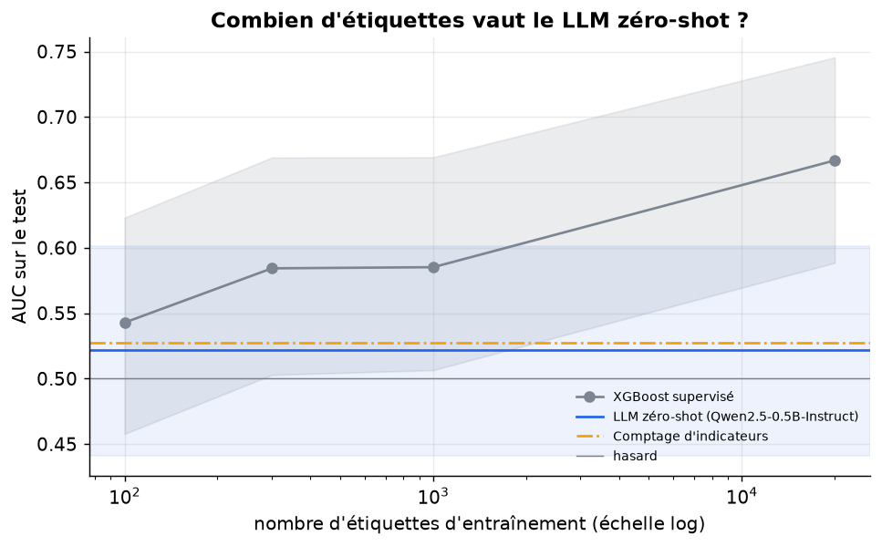
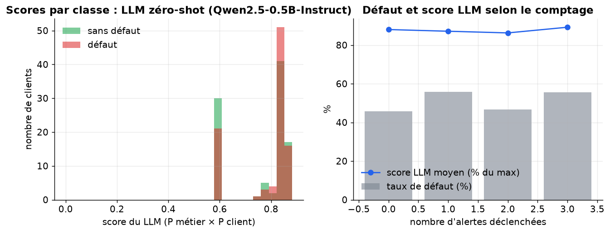
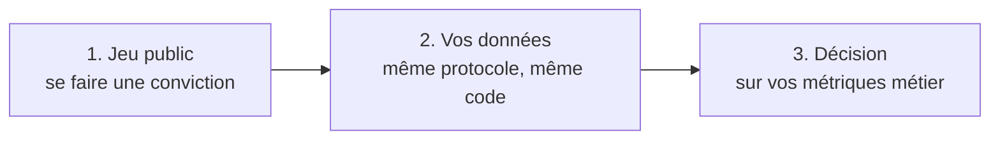

# Un petit LLM ouvert, interrogé en zéro-shot sur un dossier de risque calculé par code, égale-t-il un GBDT appris sur ~1 000 clients étiquetés (défaut de crédit) ?

> **En bref.** Non concluant : le petit modèle de substitution ne lit pas le dossier et reste au niveau du hasard. L'expérience ne dit rien sur l'approche de la source, seulement que ce modèle est trop petit. AUC : 0,522 [0,441 ; 0,601] pour LLM zéro-shot (Qwen2.5-0.5B-Instruct), contre 0,667 [0,589 ; 0,746] pour XGBoost, 20000 étiquettes (192 exemples de test, échelle réduite, chiffres indicatifs).

## Sommaire

1. [La question](#la-question)
2. [Le protocole](#le-protocole)
3. [Les résultats](#les-résultats)
4. [Ce qu'il faut retenir](#ce-quil-faut-retenir)
5. [Rejouer l'expérience](#rejouer-lexpérience)
6. [Contenu du dépôt](#contenu-du-dépôt)
7. [Références](#références)
8. [Glossaire](#glossaire)

## La question

L'expérience demande si un petit modèle de langage ouvert peut estimer le risque de défaut d'un demandeur de crédit aussi bien qu'un modèle classique, sans avoir vu aucun exemple étiqueté. Le code calcule d'abord des signaux d'alerte simples, comme une mensualité trop lourde ou un emploi très récent, et les range dans un dossier. Le modèle de langage lit ce dossier et dit oui ou non à « ce client est-il à haut risque ? ». On lit la probabilité qu'il réponde oui. Ce score est comparé au simple nombre d'alertes et à un modèle XGBoost entraîné sur 100 à plusieurs milliers de clients dont on connaît l'issue. La comparaison indique combien d'étiquettes le modèle de langage « vaut », donc s'il peut servir à démarrer quand on n'a pas encore d'historique.

**Hypothèse testée.** L'AUC du score zéro-shot (P(« Yes ») d'un LLM ≤3B sur un dossier à indicateurs d'alerte précoce) dépasse celle du simple comptage d'indicateurs d'au moins 0,03 et atteint celle d'un XGBoost entraîné sur 300 à 1 000 clients ; XGBoost entraîné sur toutes les étiquettes reste devant d'au moins 0,05 d'AUC.

| | Référence | Nouvelle approche |
|---|---|---|
| **Approche** | XGBoost supervisé à budget d'étiquettes variable | Score zéro-shot LLM sur dossier structuré (équivalent ouvert de JevRisk) |
| **Principe** | Classifieur à arbres boostés entraîné sur N demandes étiquetées (N = 100, 300, 1 000, 3 000, toutes) avec les variables brutes de la demande, plus une baseline sans apprentissage : le nombre d'indicateurs d'alerte précoce déclenchés. | Le code calcule les indicateurs et monte un dossier JSON (profil, montants, indicateurs avec statut et chiffre). Un LLM ouvert répond à deux questions fermées (métier à haut risque ? client à haut risque ?) ; le score est le produit des probabilités de « Yes », lues sur les logits du premier token, sans génération. |
| **Mise en œuvre** | xgboost.XGBClassifier (n_estimators 300, max_depth 4, learning_rate 0.05) ; variables catégorielles encodées ordinalement ; 10 tirages par N pour N<all ; indicateurs : mensualité/revenu > 0,35, crédit/revenu > 5, ancienneté d'emploi < 1 an, âge < 25 ans, crédit > 95e percentile de la période de développement, revenu < 25e percentile. | transformers AutoModelForCausalLM en float16, un seul passage avant par client, lots triés par longueur ; probabilité = softmax restreint aux tokens « Yes »/« No » ; question métier posée une fois par valeur distincte d'OCCUPATION_TYPE (mise en cache). Genre, scores externes EXT_SOURCE_* et identifiants exclus du dossier. Deux tailles comparées pour juger l'effet d'échelle. |
| **Modèles** | — | [`Qwen/Qwen2.5-3B-Instruct`](https://huggingface.co/Qwen/Qwen2.5-3B-Instruct), [`Qwen/Qwen2.5-1.5B-Instruct`](https://huggingface.co/Qwen/Qwen2.5-1.5B-Instruct) |

## Le protocole



- **Données** : [`mohameddhameem/home-credit-default-risk`](https://huggingface.co/datasets/mohameddhameem/home-credit-default-risk) (configuration `application_train_dated`), évaluation sur le découpage `train` (192 exemples). Demandes réelles de crédit à la consommation avec défaut observé et date : permet l'AUC, un découpage temporel (fait dans le notebook à partir du split unique « train », selon application_date) et la courbe AUC selon le nombre d'étiquettes.
- **Écarts avec des données réelles** : Prêteur d'Europe de l'Est, pas de marché français ; date probablement reconstituée (à vérifier) ; indicateurs tirés de la seule table de demande ; prompts en anglais ; volet AML non couvert (pas de KYC ni de transactions par canal en libre) ; LLM ouvert ≤3B au lieu de Jev, donc plancher de ce que l'approche peut donner.
- **Déroulé** : Les données sont les demandes de crédit publiques Home Credit (config application_train_dated). Elles sont découpées dans le temps selon application_date : les 80 % les plus anciens servent au développement, dans lequel on échantillonne jusqu'à 100 000 demandes, et les 20 % les plus récents forment la réserve de test, où l'on tire un test équilibré de 2 000 clients dont 1 000 défauts. Les seuils percentiles des indicateurs sont calculés sur le développement seulement. Quatre familles de scores sont comparées : le comptage de six indicateurs, XGBoost (300 arbres, profondeur 4, pas 0,05) entraîné sur N = 100, 300, 1 000, 3 000 ou toutes les étiquettes avec 10 tirages par N, et un LLM Qwen2.5 3B et 1,5B en zéro-shot, qui lit P(« Yes ») sur les logits du premier token de deux questions fermées. La métrique principale est l'AUC, avec un intervalle bootstrap à 95 % (1 000 rééchantillonnages). S'y ajoutent le rappel pondéré dans le top 5 %, un bootstrap apparié de la différence d'AUC face au LLM, le point d'équivalence en étiquettes, les tokens et la latence par client, et une AUC par genre en contrôle d'équité.
- **Deux échelles, un seul code** : l'échelle réduite (192 exemples, CPU, 7 min) valide la mécanique ; l'échelle complète n'a pas été exécutée (approches ou métriques différentes de celles de l'échelle réduite) : résultats indicatifs.



*Gauche : demandes par mois et taux de défaut (%), frontière temporelle en pointillés. Droite : effectifs par classe (développement échantillonné, test équilibré).*

**Les métriques**

| Métrique | Ce qu'elle mesure | Meilleur si |
|---|---|---|
| AUC ★ | Probabilité qu'un client en défaut soit classé au-dessus d'un client sain : 0,5 correspond au hasard, 1 à un classement parfait. | plus haut |
| AUC, borne basse IC 95 % | Borne basse de l'intervalle de confiance bootstrap de l'AUC ; au-dessus de 0,5, l'approche bat le hasard. | plus haut |
| AUC, borne haute IC 95 % | Borne haute de l'intervalle de confiance bootstrap de l'AUC ; avec la borne basse, elle dit à quel point le chiffre dépend de l'échantillon. | — |
| Rappel dans le top 5 % (pondéré) | Part des défauts retrouvés en revoyant les 5 % de dossiers les mieux classés, ramenée au taux de défaut réel. | plus haut |
| Étiquettes d'entraînement | Nombre de clients étiquetés utilisés pour apprendre (0 pour le LLM et le comptage). | — |
| Tokens par client | Taille moyenne du texte lu par le LLM pour un client, questions métier amorties comprises ; sans objet (None) hors LLM. | plus bas |
| Latence par client (ms, médiane) | Temps médian d'inférence nécessaire pour noter un client, en millisecondes. | plus bas |

★ métrique principale : c'est elle qui tranche la question.

## Les résultats

| Approche | AUC ★ ↑ | AUC, borne basse IC 95 % ↑ | AUC, borne haute IC 95 % | Rappel dans le top 5 % (pondéré) ↑ | Étiquettes d'entraînement | Tokens par client ↓ | Latence par client (ms, médiane) ↓ | Latence médiane (ms) ↓ |
|---|---|---|---|---|---|---|---|---|
| Comptage d'indicateurs (référence) | 0,527 [0,452 ; 0,606] | 0,452 | 0,606 | 0,0521 [0,0103 ; 0,133] | 0 | — | **0,00717** | 0,01 |
| XGBoost, 100 étiquettes (référence) | 0,543 [0,458 ; 0,623] | 0,458 | 0,623 | 0,0208 [0 ; 0,135] | 100 | — | 0,0123 | 0,01 |
| XGBoost, 300 étiquettes (référence) | 0,584 [0,503 ; 0,669] | 0,503 | 0,669 | 0,0833 [0,0202 ; 0,248] | 300 | — | 0,0124 | 0,01 |
| XGBoost, 1000 étiquettes (référence) | 0,585 [0,507 ; 0,669] | 0,507 | 0,669 | 0,0938 [0,0114 ; 0,165] | 1e+03 | — | 0,0125 | 0,01 |
| XGBoost, 20000 étiquettes (référence) | **0,667 [0,589 ; 0,746]** | **0,589** | 0,746 | **0,177 [0,0982 ; 0,298]** | 2e+04 | — | 0,0124 | 0,01 |
| LLM zéro-shot (Qwen2.5-0.5B-Instruct) (nouvelle approche) | 0,522 [0,441 ; 0,601] | 0,441 | 0,601 | 0,0521 [0 ; 0,112] | 0 | 364 | 2,08e+03 | 2,08e+03 |

★ métrique principale · ↑ plus haut = meilleur · ↓ plus bas = meilleur · entre crochets : intervalle de confiance à 95 % (bootstrap) · en gras : la meilleure valeur.



*Valeur de chaque métrique par approche (★ : métrique principale, à maximiser) ; les barres d'erreur donnent l'intervalle de confiance à 95 % sur 192 exemples de test.*



*AUC de XGBoost selon le nombre d'étiquettes (bande : IC 95 %), comparée aux approches sans étiquette (lignes horizontales). Le croisement donne le budget d'étiquettes équivalent.*



*Gauche : distribution des scores du LLM par classe (plus elles sont séparées, meilleure est l'AUC). Droite : taux de défaut du test équilibré et score moyen du LLM selon le nombre d'alertes.*

**Lecture** (confiance elevee). À l'échelle réduite (modèle de 0,5 milliard de paramètres sur CPU, 192 clients de test, un seul tirage d'étiquettes par budget), le LLM zéro-shot obtient une AUC de 0,522 [0,441 ; 0,601], au niveau du hasard et du comptage d'indicateurs (0,527). Le contrôle positif échoue : le modèle ne distingue pas un dossier très risqué d'un dossier sain. XGBoost entraîné sur 20 000 étiquettes est le seul à se distinguer (0,667, écart apparié de +0,145). Ces chiffres ne permettent pas de trancher sur l'approche, ni de la comparer aux résultats de la source obtenus avec un modèle bien plus capable. La comparaison est construite équitablement (mêmes clients, mêmes variables, seuils tirés du développement). Elle n'a simplement pas la puissance pour conclure.

## Ce qu'il faut retenir

**Réserves**

- Ce petit modèle répond presque toujours « oui », que le dossier soit sain ou très risqué. Son AUC proche du hasard ne dit rien sur ce que donnerait un modèle de décision plus gros.
- Avec 192 clients et un seul tirage par budget, on ne peut pas dire combien d'étiquettes « vaut » le LLM. Les écarts entre approches sont dans la marge d'erreur, sauf pour le modèle supervisé entraîné sur toutes les étiquettes.

**Limites**

- Le prêteur est d'Europe de l'Est et la date est probablement reconstituée : le découpage temporel peut ne pas refléter une vraie dérive dans le temps.
- Les six indicateurs ne viennent que de la table de demande ; aucun historique de remboursement ni de comportement n'est utilisé, ce qui plafonne toutes les approches.
- Les LLM ouverts de 3 Md de paramètres au plus sont bien plus petits que le modèle de la source : le résultat est un plancher de ce que l'approche peut donner.
- Le contrôle d'équité se limite à une AUC par genre ; le métier reste un proxy possible et un audit complet manque.
- À l'échelle réduite, 200 clients et un modèle 0,5B donnent des intervalles larges, qui ne permettent pas de trancher.

**Pistes d'amélioration**

- Le test est « plus récent » seulement au sens de la colonne de date du jeu. Il ne prouve pas que la méthode tient face à une vraie dérive dans le temps.
- Les latences (environ 2 s par client pour le LLM) valent pour ce processeur et ce petit modèle. Elles ne se transposent pas à un service de production.
- Ces AUC par sexe ne prouvent ni la présence ni l'absence de biais. Le test d'équité complet reste à faire avant tout usage.

## Rejouer l'expérience



### Sur le jeu public

```bash
pip install -r requirements.txt
jupyter lab experiment.ipynb
```

Dans la cellule de paramètres : `PHASE = "public"`, puis `SCALE = "reduced"` (quelques minutes sur CPU, pour vérifier) ou `SCALE = "full"` (résultats publiés). Les résultats sont écrits dans `outputs/results_public.json`, les figures dans `outputs/figures/` (les résultats publiés en sont une copie, dans `results/` et `figures/`).

### Sur vos données (environnement de services financiers)

Le même protocole, sur vos données, dans votre environnement : seule la cellule `PRIVATE_CONFIG` s'adapte. Le code de cette phase a été exécuté de bout en bout sur un jeu factice écrit comme un vrai export (dossier de fichiers, CSV « ; » en Windows-1252, colonnes à faire correspondre), contre un service simulé à la convention OpenAI (clé lue dans un fichier de secret), modèles chargés hors ligne.

**1. Préparer le jeu de données.** Colonnes attendues (les noms peuvent différer : on les fait correspondre dans `PRIVATE_CONFIG["columns"]`) :

| Colonne attendue | Type | Contenu |
|---|---|---|
| `customer_id` | string | Identifiant pseudonymisé du client ou du dossier. |
| `application_date` | datetime | Date de la demande ou de la revue, pour le découpage temporel. |
| `occupation` | string | Profession ou code métier (sans identité). |
| `age` | integer | Âge à la date de la demande. |
| `income` | float | Revenu déclaré annuel. |
| `credit_amount` | float | Montant demandé ou encours. |
| `annuity` | float | Mensualité ou échéance. |
| `employment_years` | float | Ancienneté d'emploi ou de relation. |
| `target` | integer | 1 si défaut ou risque confirmé dans la fenêtre d'observation, sinon 0. |

Volume conseillé : Au moins 4 000 clients de test (dont 2 000 à risque) et 30 000 clients de développement étiquetés, sur au moins 18 mois.

**Conditions pour que la comparaison soit concluante**

- Étiquette observée à posteriori (défaut ou issue de revue), pas une note interne dérivée des mêmes variables.
- Au moins 2 000 positifs au test, et 500 positifs au développement.
- Découpage temporel : développement strictement antérieur au test, fenêtre d'observation du défaut complète.
- Exclure scores internes et variables postérieures à la décision (fuite).
- Pseudonymiser, retirer nom, adresse, genre et identifiants directs ; LLM servi uniquement dans l'environnement cible.
- Seuils d'indicateurs fixés depuis les textes réglementaires ou les percentiles de la période de développement, jamais du test.
- Fournir la période et la politique d'octroi, pour juger le biais de sélection.

**Constituer l'extraction.** Extraire les demandes de crédit ou dossiers clients avec issue observée depuis les entrepôts de décision, joindre profil et historique agrégé, filtrer les dossiers incomplets, échantillonner les positifs et les négatifs au test, et conserver l'ordre chronologique pour le découpage.

**2. Rendre les modèles disponibles hors ligne** (si l'environnement n'a pas accès à Internet) :

```bash
python download_models.py ./models --scale full   # sur un poste connecté
```

puis copier le dossier dans l'environnement et le désigner par `LOCAL_MODELS_DIR`. Les révisions téléchargées sont celles des résultats publiés.

**3. Configurer** l'environnement du notebook à partir de `private.env.example` (ou directement la cellule `PRIVATE_CONFIG`). Jamais de clé dans le notebook : une variable, un fichier de secret monté ou la saisie masquée.

| Variable | Rôle |
|---|---|
| `PRIVATE_DATA` | jeu de données : fichier ou dossier (csv, tsv, parquet, jsonl, json, xlsx) ; `fake` pour tester le code sur un jeu factice |
| `LOCAL_MODELS_DIR` | (facultatif) dossier des poids copiés localement (`org--nom/`), pour travailler sans Internet |
| `LLMAAS_BASE_URL, LLMAAS_MODEL` | service LLM interne à la convention OpenAI (URL en `/v1`, nom du modèle) |
| `LLMAAS_API_KEY ou LLMAAS_API_KEY_FILE` | clé du service, par variable ou par fichier de secret monté |
| `<SERVICE>_HEADERS` | (facultatif) en-têtes HTTP exigés par la passerelle, objet JSON |
| `HTTPS_PROXY, SSL_CERT_FILE, PIP_INDEX_URL` | (facultatif) proxy, autorité de certification et miroir PyPI d'entreprise |
| `SERVICE_TIMEOUT_S, SERVICE_MAX_RETRIES` | (facultatif) délai (120 s) et tentatives (3) par appel de service |

**4. Lancer** avec `PHASE = "private"` (et `SCALE = "full"`). La cellule d'initialisation affiche une liste de contrôle (jeu, colonnes, modèles, services) et s'arrête sur ce qui manque, avant tout calcul. Les résultats sont écrits dans `outputs/results_private.json` (avec versions, machine, graine et empreinte des données).

**5. Interpréter.** Métriques métier à suivre : AUC, rappel dans les 5 % de dossiers les mieux classés (charge de revue), AUC selon le nombre d'étiquettes, coût par client.

**Garde-fous.** Outil de tri des dossiers à revoir, pas de décision automatique (scoring crédit des particuliers à haut risque au sens de l'AI Act) ; aucune donnée client vers une API externe ; test d'équité obligatoire avant tout usage ; variables protégées et leurs proxys (métier) exclus ou audités. En phase `private`, le notebook refuse les services publics (OpenAI, Anthropic, Mistral, Hugging Face…) et le HTTP non chiffré, n'affiche aucune donnée brute et coupe la télémétrie des bibliothèques ; avec `LOCAL_MODELS_DIR`, il travaille sans accès à Internet.

## Contenu du dépôt

| Fichier | Contenu |
|---|---|
| `experiment.ipynb` | le notebook : question, données, deux approches, évaluation, analyse, bilan (sorties incluses) |
| `helpers.py` | fonctions communes : phases et échelles, services internes, lecture des données, mesures, figures |
| `results/results.json` | résultats publiés (échelle réduite) : métriques, intervalles, latences, versions et machine |
| `figures/` | figures du notebook reprises dans ce README |
| `requirements.txt` | versions exactes des bibliothèques utilisées |
| `private.env.example` | variables d'environnement pour exécuter le notebook sur vos données |
| `download_models.py` | téléchargement des poids des modèles, pour un environnement sans Internet |

## Références

**Sources de l'approche**

- [JevRisk: Zero-Shot Financial Risk Assessment with a Language Decision Model (arXiv 2611.26999)](https://arxiv.org/abs/2611.26999)
- [TypeSafe Jev pricing (2026): $0.042 per million tokens, output free (eesel.ai)](https://www.eesel.ai/blog/typesafe-jev-pricing)

**Autres jeux de données examinés**

| Jeu | Accès | Intérêt | Pourquoi pas ici |
|---|---|---|---|
| [codesignal/lending-club-loan-accepted](https://huggingface.co/datasets/codesignal/lending-club-loan-accepted) | Hugging Face, libre | Prêts 2007-2018 avec issue_d, mais 151 colonnes dont beaucoup postérieures à l'octroi. | Risque de fuite de cible et effectif non confirmé ; Home Credit suffit pour un premier verdict. |
| [scotiabank-big-data-team/2026-scotiabank-imi-big-data-ai](https://huggingface.co/datasets/scotiabank-big-data-team/2026-scotiabank-imi-big-data-ai) | compte requis | KYC, métiers, transactions par canal et labels : le jeu AML idéal. | Accès conditionnel (gated), licence inconnue, identité avec l'article non prouvée ; à demander pour la suite AML. |
| [AMLGentex/sweden_100K_easy](https://huggingface.co/datasets/AMLGentex/sweden_100K_easy) | Hugging Face, libre | Transactions AML avec isSAR (7,8 M lignes). | Aucun profil KYC : l'apport du jugement selon le profil ne peut pas être mesuré. |
| [VynFi/vynfi-aml-100k](https://huggingface.co/datasets/VynFi/vynfi-aml-100k) | Hugging Face, libre | Transactions synthétiques par canal avec étiquette de suspicion. | Niveau transaction, profil KYC non confirmé, signaux probablement trop propres. |
| [scikit-learn/credit-card-clients](https://huggingface.co/datasets/scikit-learn/credit-card-clients) | Hugging Face, libre | 30 000 clients, défaut de paiement, petit. | Données taïwanaises de 2005, sans date ni métier ; trop petit pour un test de 2 000 clients et un GBDT à 3 000 étiquettes. |
| [sovereign-forger/kyc-aml-sample-data](https://huggingface.co/datasets/sovereign-forger/kyc-aml-sample-data) | Hugging Face, libre | 5 profils KYC/AML synthétiques. | 5 lignes et licence cc-by-nc-4.0. |

**Licences**

- Jeu de données `mohameddhameem/home-credit-default-risk` : apache-2.0
- `Qwen/Qwen2.5-3B-Instruct` : other (licence propre au modèle : lire ses conditions, notamment d'usage commercial)
- `Qwen/Qwen2.5-1.5B-Instruct` : apache-2.0
- `Qwen/Qwen2.5-0.5B-Instruct` : apache-2.0
- Vérifier la licence de chaque modèle avant tout usage au-delà de l'évaluation.

## Glossaire

| Terme | Définition |
|---|---|
| **Zéro-shot** | Utiliser un modèle sans lui montrer aucun exemple étiqueté de la tâche : il répond seulement d'après la question et le dossier. |
| **AUC** | Aire sous la courbe ROC : probabilité qu'un client en défaut reçoive un score plus élevé qu'un client sain. |
| **Bootstrap** | On retire des clients au hasard, avec remise, des centaines de fois, pour voir à quel point un chiffre dépend de l'échantillon et en déduire un intervalle de confiance. |
| **Bootstrap apparié** | Bootstrap qui tire les mêmes clients pour deux approches à la fois, afin de mesurer l'incertitude sur leur différence. |
| **Logits du premier token** | Scores bruts que le LLM donne à chaque mot possible pour commencer sa réponse ; on en tire P(« Yes ») sans générer de texte. |
| **Indicateur d'alerte précoce** | Règle simple à seuil, par exemple une mensualité supérieure à 35 % du revenu, qui signale un dossier à surveiller. |
| **XGBoost (GBDT)** | Modèle supervisé fait de nombreux petits arbres de décision ajoutés les uns après les autres, chacun corrigeant les erreurs des précédents. |
| **Découpage temporel** | On apprend sur les demandes les plus anciennes et on teste sur les plus récentes, comme dans un usage réel. |
| **Point d'équivalence** | Plus petit nombre d'étiquettes à partir duquel XGBoost dépasse significativement le LLM zéro-shot. |
| **Contrôle positif** | Test sur deux cas évidents (très risqué, très sûr) pour vérifier que le modèle lit vraiment le dossier. |
